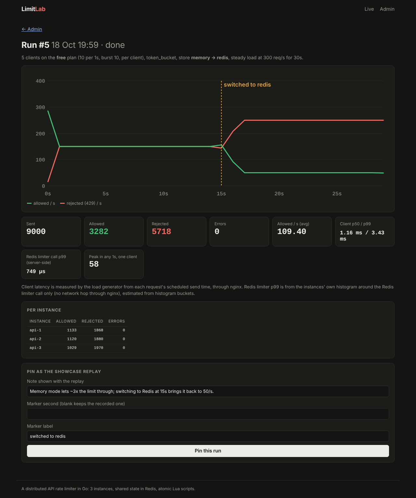

# Distributed Rate Limiter

A rate limiter for an API that runs as 3 instances behind a load balancer, written in Go with Redis.



## Why I built this

Most rate limiter examples run on one server. I wanted to see what happens when the same API runs as 3 copies
behind nginx, which is how it usually runs in production.

If each instance counts requests in its own memory, each one only sees a third of the traffic. A client limited to
10 requests/second ends up getting about 30 through. I built the project to show that problem, fix it, and measure
the fix.

## How it works

Each request goes through nginx to one of the 3 API instances. The instance checks the API key, then asks Redis
whether the request is allowed. The check runs as a Lua script, so reading the counter, updating it and deciding
happen in one atomic step. Two instances can't both see "1 left" and both allow.

```
Caddy (HTTPS) ──► nginx (round-robin) ──► api-1 ┐
                                       ├──► api-2 ├──► Redis     (shared counters, Lua)
                                       └──► api-3 ┘    Postgres  (keys, rules, test results)
dashboard ── shows live traffic and runs load tests
```

I implemented two algorithms: token bucket (default) and fixed window.

If Redis goes down, every call times out after 15 ms and a circuit breaker stops calling Redis. Each instance then
limits on its own at a third of the limit, so the API stays up and the limit is roughly right.

## Results

Measured with the built-in load tester (5 clients, 300 req/s offered, limit 10 req/s per client, 30 s):

- In-memory limiting: about **3x** the limit got through (2.98x)
- Redis: **1,545** allowed out of a maximum of 1,550, so **1.00x**
- Redis limiter call: **under 1 ms at p99** (733–933 µs), **0 errors**
- Redis stopped in the middle of a test: **0 errors**, traffic dropped slightly to the fallback limit
- API key lookups: **99.6%** served from an in-memory cache instead of Postgres

All 3 instances run on one machine, so read the latency numbers as relative.

## Run it locally

You need Docker Desktop.

```bash
cp .env.example .env      # then set the passwords and secrets in .env
docker compose up -d --build
```

- Live page: http://localhost:8000. Click "Send a request" a few times to see a 429.
- Admin: http://localhost:8000/admin. Run a load test in `memory` mode, switch to `redis` halfway, and watch the
  allowed line drop from about 150/s to 50/s.

## Tests

```bash
make test               # unit tests
make test-integration   # real Redis and Postgres
```

The main integration test starts 3 instances behind a proxy, sends 10x the limit and checks that Redis keeps traffic
under the limit while in-memory mode lets about 3x through. CI runs the tests, `go vet` and `govulncheck` on every push.

## Limitations

- Redis is a single point of failure. The circuit breaker covers it, but there's no replication.
- Everything runs on one machine, so there's no real network latency between instances.
- The fallback limit assumes traffic is spread evenly across instances.
- Fixed window can let up to 2x through around a window boundary (that's why token bucket is the default).

More detail on the design choices is in [docs/DESIGN.md](docs/DESIGN.md).